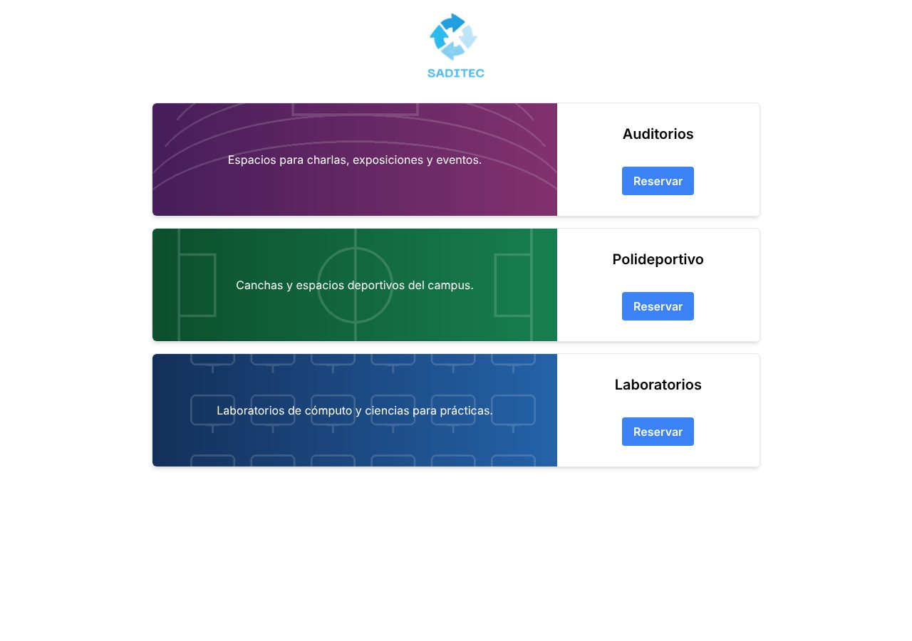
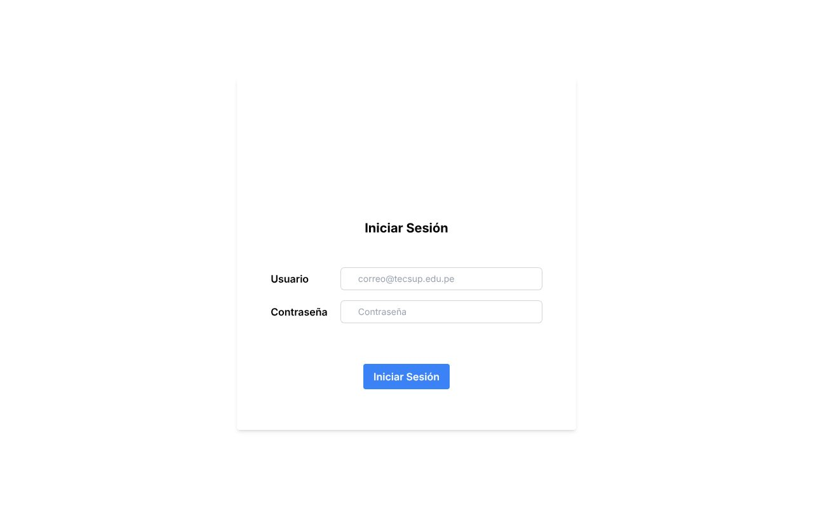
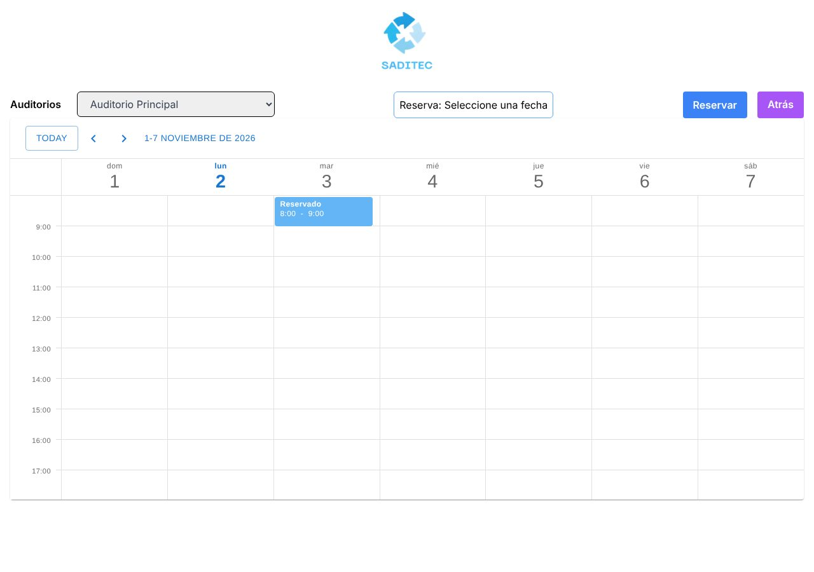

# SADITEC · Reservas (Frontend)

Aplicación web donde los alumnos reservan laboratorios, canchas y auditorios en un calendario semanal. Está hecha con **Next.js 14 (App Router)**, **TypeScript** y **Tailwind CSS**, y consume la API de [briansaa/back-servicio](https://github.com/briansaa/back-servicio).



## Funcionalidades

- **Login con JWT.** El token se guarda en una cookie y el middleware de Next.js lo valida con `jose` antes de cada ruta protegida.
- Redirección por rol: los administradores van a `/admin`.
- Catálogo de tipos de espacio con imagen y descripción.
- **Calendario semanal** (DevExpress Scheduler) con los horarios disponibles y las reservas existentes.
- Reserva con un clic. Si la API rechaza el horario porque ya está ocupado, se muestra el motivo.
- Avisos con `react-toastify`.

| Login | Reserva |
|---|---|
|  |  |

## Stack

Next.js 14 · React 18 · TypeScript · Tailwind CSS · Server Actions · jose (JWT) · DevExpress React Scheduler · Material UI

## Cómo correrlo

1. Levanta la API (ver [back-servicio](https://github.com/briansaa/back-servicio)). En local crea un usuario de ejemplo al registrarte.
2. Configura las variables y arranca:

```bash
cp .env.example .env.local
npm install
npm run dev        # http://localhost:3000
```

| Variable | Descripción |
|---|---|
| `baseUrl` | URL de la API, p. ej. `http://localhost:10000/apiv1` |
| `secretKey` | La misma clave Base64 que `JWT_SECRET` del backend |

Build de producción: `npm run build && npm start`.

## Estructura

```
app/
├── login/                       # página de login (form + server action)
├── reservation/[...identifier]/ # calendario y creación de reservas
├── page.tsx                     # catálogo de espacios
└── src/
    ├── lib/                     # llamadas a la API (server actions), cookies, JWT
    ├── models/                  # tipos TypeScript de la API
    └── ui/                      # componentes: formulario, calendario, header
middleware.ts                    # protege rutas y valida el JWT
```

## Autores

- **Abraham Balboa**: frontend
- **[Brian Saavedra](https://github.com/briansaa)**: backend e integración
